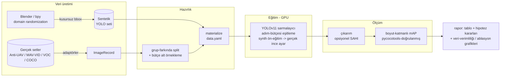
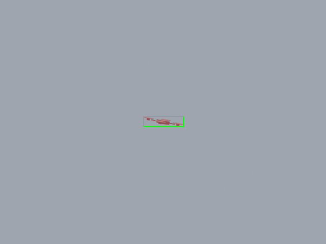
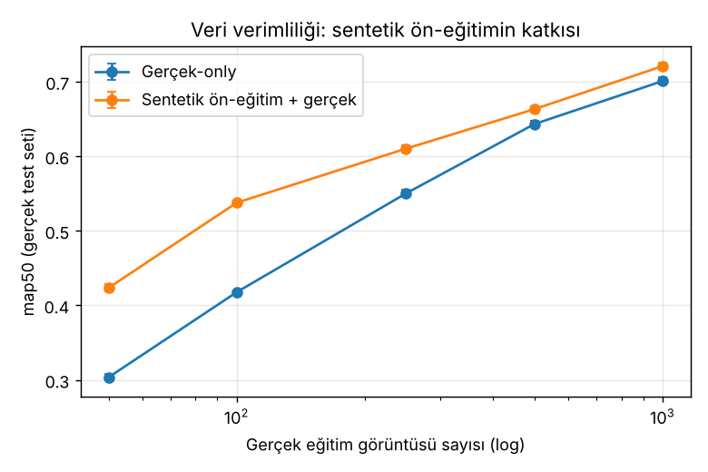

# MirageBench

**Küçük İHA/drone tespitinde sentetik eğitim verisinin gerçek veri açığını ne kadar
kapattığını ölçen kontrollü bir benchmark.**

MirageBench "bir model eğittim" deposu değil, küçük bir **ampirik çalışmadır**. Soru
nettir: Blender ile üretilen sentetik drone görüntüleri, gerçek küçük-nesne tespit
başarısını ne kadar artırır; hangi koşulda ve hangi tasarım seçimiyle? Kod, bu soruyu
tekrar üretilebilir biçimde yanıtlamak için vardır.

Çalışma tasarımı, hipotezler ve karar kuralları: [`docs/RESEARCH.md`](docs/RESEARCH.md).

---

## Neden bu proje

"Sentetik veri yardımcı olur" iddiası literatürde sık; ama *ne kadar*, *hangi
rejimde* ve *hangi domain-randomization faktörü sayesinde* sorularına temiz,
referansla doğrulanmış metrikle yanıt veren açık bir çalışma azdır. MirageBench bu
boşluğu doldurur:

- **Kontrollü deney**: model, artırma ve eğitim bütçesi tüm kollarda sabit; yalnız
  eğitim verisinin bileşimi değişir. Gözlenen fark veriye atfedilebilir.
- **Referansla doğrulanmış ölçüm**: boyut-katmanlı mAP motoru sıfırdan yazıldı ve
  `pycocotools` ile **4 ondalık basamağa kadar** uyumlu (bkz. `tests/test_eval_map.py`).
- **Kusursuz sentetik etiket**: bbox render pikselinden değil, 3B mesh köşelerinin
  kamera matrisiyle projeksiyonundan üretilir; gölge/blur/saydamlık etiketi bozmaz.
- **Sızıntısız protokol**: grup-farkında split (aynı videodan kareler train/test'e
  bölünmez), deterministik veri-bütçesi alt örnekleme, çok-tohumlu belirsizlik.

---

## Sistem mimarisi



Deney kolları (`configs/arms/`): `real_only_{N}`, `synth_only`,
`synth_pretrain_real_{N}`, `mixed_{N}`, `ablation_{faktör}`.

---

## Örnek rapor çıktısı

> ⚠️ Aşağıdaki figürler **yer tutucu (fabrike) verilerle** üretilmiştir; rapor
> hattının çalıştığını gösterir, gerçek deney bulgusu **değildir**. Gerçek sonuçlar
> veri setleri ve GPU eğitimi ile üretilir.

Sentetik üreticinin ürettiği kusursuz bbox (prosedürel quadcopter, gerçek render):



Rapor hattının ürettiği veri-verimliliği eğrisi (hat demonstrasyonu):



---

## Kurulum

```bash
# Çekirdek (CPU): veri hattı, değerlendirme, rapor
pip install -e ".[report,dev]"

# Sentetik üretim (Blender modülü)
pip install bpy            # ya da sistemdeki `blender` çalıştırılabiliri kullanılır

# Eğitim/çıkarım (GPU, ör. RTX 4070)
pip install -e ".[train]"
```

Docker (CUDA + Ultralytics + bpy): `docker build -t miragebench -f docker/Dockerfile .`

---

## Hızlı başlangıç

```bash
# 1) Sentetik veri üret (full + ablasyon faktörleri)
python -m miragebench.synth.cli --out data/synth/full            --n 20000 --factor full
python -m miragebench.synth.cli --out data/synth/no_light_random --n 20000 --factor no_light_random

# 2) Gerçek seti içeri al (grup-farkında split)
python -m miragebench.data.cli --format yolo --root /veri/anti_uav --out data/real --merge-classes

# 3) Veri kompozisyonunu GPU'suz doğrula
python -m miragebench.experiment.cli --dry-run \
  --arm configs/arms/*.yaml --real-root data/real --synth full=data/synth/full --seeds 0

# 4) Kolları çalıştır (GPU)
python -m miragebench.experiment.cli \
  --arm configs/arms/real_only_250.yaml configs/arms/synth_pretrain_real_250.yaml \
  --real-root data/real --synth full=data/synth/full no_light_random=data/synth/no_light_random \
  --seeds 0 1 2 --results results/

# 5) Rapor + grafikler + hipotez kararları
python -m miragebench.report.cli --results results/ --out docs/report
```

`make help` yaygın iş akışlarını listeler.

---

## Depo yapısı

```
miragebench/
  config/      pydantic şema + base/arm yükleme (kontrollü deney doğrulaması)
  synth/       geometry (projeksiyon) · factors (ablasyon) · assets · blender_generator
  data/        adapters (YOLO/COCO/VOC) · records · split · materialize
  eval/        metrics (boyut-katmanlı mAP, pycocotools-doğrulanmış) · io
  experiment/  train_wrapper (YOLOv11, adım-bütçesi) · runner · cli
  report/      aggregate (hipotez kararları) · plots
configs/       base.yaml + arms/*.yaml
tests/         42 test; mAP çapraz-doğrulama, projeksiyon, split sızıntısı, hipotez mantığı
docs/          RESEARCH.md (çalışma tasarımı) · figures/
docker/        CUDA + Ultralytics + bpy imajı
```

---

## Doğrulama

```bash
pytest tests/ -q        # 42 test
```

Öne çıkan testler:
- `test_eval_map.py` — boyut-katmanlı mAP'in `pycocotools` ile sayısal uyumu (≤1e-3).
- `test_geometry.py` — kamera projeksiyonunun analitik referansla uyumu.
- `test_data_pipeline.py` — grup-farkında split'in sızıntısızlığı, alt örnekleme determinizmi.
- `test_blender_smoke.py` — render edilen karede bbox'ın drone piksellerini sarması (bpy gerekir).
- `test_experiment_and_report.py` — adım-bütçesi eşitleme ve hipotez karar mantığı.

---

## Kapsam ve sınırlar (dürüst)

- Sonuçlar seçilen gerçek sete özgü olabilir; en az iki kaynakta çapraz doğrulama
  önerilir (gelecek iş).
- Az sayıda 3B varlık sentetik çeşitliliği sınırlar — bu, ölçülen sentetik katkının
  muhtemelen bir **alt sınır** olduğu anlamına gelir.
- Prototip render EEVEE (hızlı) ile; foto-gerçekçilik etkisi Cycles ile tekrar
  ölçülmeli. Doku-gerçekçiliği ablasyonu bu farkı doğrudan hedefler.
- **Negatif sonuç da sonuçtur**: sentetik veri beklendiği kadar yardımcı olmadıysa bu
  da raporlanır. Değer, bulgunun yönünde değil, ölçümün güvenilirliğindedir.

## Lisans

MIT — bkz. [`LICENSE`](LICENSE).
